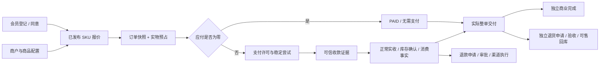
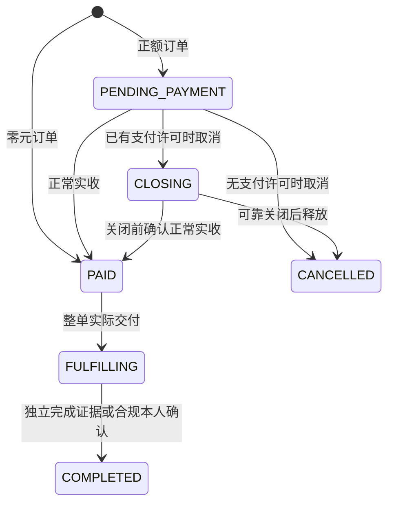
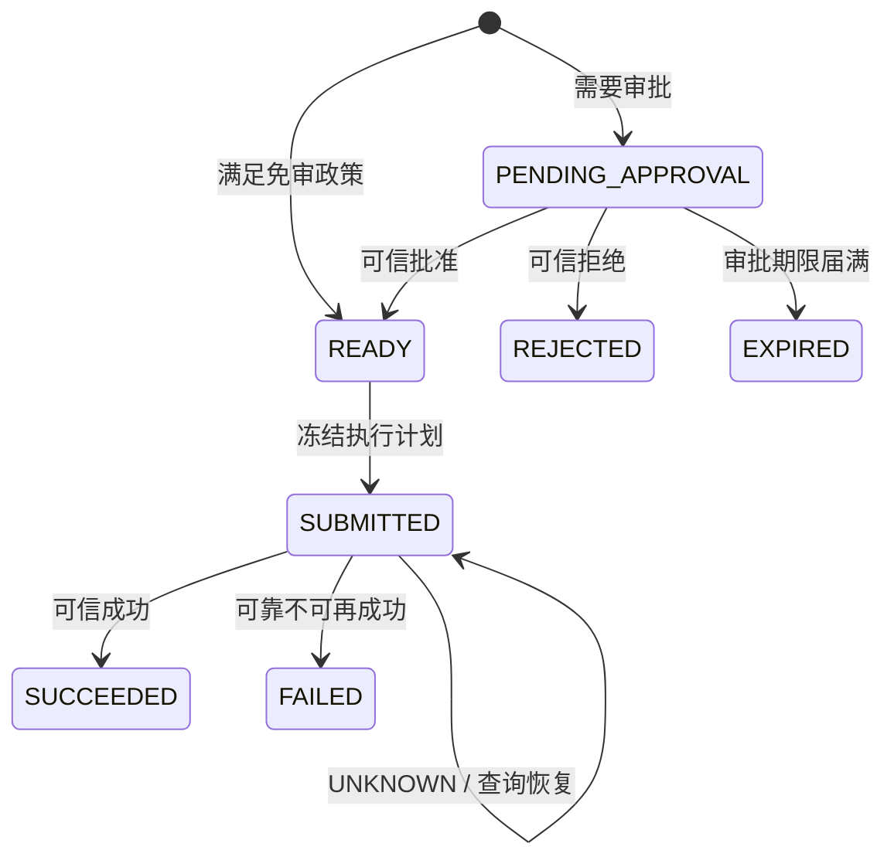

# 交易中心业务说明

日期：2026-09-08。描述当前代码中的业务规则，外部渠道或来源的真实接入另行验收。返回 [文档导航](README.md)。

## 1. 业务参与方与对象

| 参与方 | 可以发起的业务 | 约束 |
| --- | --- | --- |
| 会员 | 报价、本人下单/查单/取消、发起支付、本人退款、符合条件的确认收货 | 身份与租户取自 JWT；不能自报最终金额或修改他人订单 |
| 租户管理员 | 商户/商品/仓库配置、退款政策、运营查询和准入策略 | 管理员 scope 不自动赋予可信审批、履约或对账服务全部权限 |
| 可信审批来源 | 提交签名审批决定 | 独立签发方/受众/主体与决定版本，禁止自审自批 |
| 可信履约/仓储来源 | 整单交付、服务完成、退货验收 | 开关、scope、主体白名单和实际业务证据 |
| 支付/退款渠道 | 提供真实收款、退款及关闭结果 | 内部 Port 已有，真实渠道适配、原文验签与联调仍需接入 |
| 对账/营销平台 | 消费交易事实、提交差异、查询证据 | 交易侧不直接完成外部结案或发奖 |

关键区别：报价是服务端金额快照；订单是购买合同与商品快照；支付意图是订单收款目标；支付尝试是一次稳定渠道请求；收款是实际资金事实。退款、商业完成、实物回库各有独立状态。

## 2. 主业务流程

退款与退货可以分别发生，退款成功不自动产生回库，验收也不自动退款。图中收款正常分支以足额、同币种、订单允许为前提；异常收款另行保存及补偿。

## 3. 会员、商品与报价

会员登记和同意记录持久化；冻结限制新增交易，不抹掉历史订单或已发生消费事实。`everPaid` 与首单事实是不可逆历史信息，退款不能将客户变回“从未消费”。零元订单不产生正常收款、不设置真实 paidAt，也不占消费首单。

商品包含多个 SKU 和发布版本，管理草稿与用户可见发布视图区分。报价由服务端读取可售 SKU、校验数量并冻结金额/规格；展示缓存只能帮助浏览，报价和资金判断仍查主库。订单引用 quoteId，不接受客户端重写金额、商户或任意归因身份。

一个报价只允许创建一张订单，数据库唯一约束防止更换 HTTP 幂等键重复建单。实物订单需要同一仓库和加密地址；纯服务订单拒绝仓库/收货个人信息。下单事务会重新检查报价有效期，避免等待锁后使用过期报价。

详见 [会员生命周期](MEMBER_LIFECYCLE.md)、[SKU 与报价](SKU_AND_QUOTE.md)。

## 4. 订单状态与库存时点

此图概括主状态推进；过期由 ORDER_RESOLVE 按同样支付屏障处理，不存在仅因本地超时就忽略在途支付的释放路径。支付与取消锁定同一订单裁决，已完成可靠取消后出现的矛盾资金不复活订单。

| 时点 | 库存变化 | 业务含义 |
| --- | --- | --- |
| 实物下单 | available 减、reserved 加 | 保留待支付/履约商品 |
| 正常收款或零元下单 | reserved 减、sold 加 | 原预占确认一次 |
| 可靠取消 | reserved 减、available 加 | 原预占释放一次 |
| 实际交付/商业完成 | 不重复扣库存 | 保存独立履约事实 |
| 退款成功 | 不改变库存 | 只推进资金及退款证据 |
| 退货验收可售 | 按原预占与仓库关系回库 | 受永久数量预算保护 |

订单财务状态独立为 `UNPAID / NO_PAYMENT_REQUIRED / PAID / PARTIALLY_REFUNDED / REFUNDED`。例如已完成且部分退款的订单可同时为 `status=COMPLETED`、`financialStatus=PARTIALLY_REFUNDED`，不能把退款当作撤销履约。

## 5. 支付与不确定结果

1. 校验本人订单、会员/商户状态、渠道绑定及新增支付准入；在同事务中取得订单支付许可并建立意图/尝试及恢复任务。
2. 派发前完成本地许可和风控裁决，固定渠道商户请求号；提交事务后调用渠道。
3. 经可信验证的结果先耐久接收，再处理收款与订单。正常实收、库存确认、会员消费事实、资金流水及事件同事务提交。
4. 超时或暂时查不到是 UNKNOWN；使用原请求号查询或按可信渠道合同恢复，不盲目换号再支付。
5. 可靠不可再成功证明才允许关闭未决尝试并继续订单释放。后台任务进入 REVIEW 只表示需要核对。

| 收款分类 | 含义 | 后续效果 |
| --- | --- | --- |
| NORMAL | 首笔可接受的足额同币种资金 | 正常支付与履约库存确认一次 |
| EXCESS | 已有正常收款后又收到其他真实交易 | 保存额外资金，进入异常补偿路径 |
| AMOUNT_MISMATCH | 金额或币种不匹配 | 保存资金，核对/补偿，不正常履约 |
| AFTER_TERMINAL | 已有可靠关闭证明后出现矛盾成功 | 保留资金及原证明，不恢复旧尝试 |
| AFTER_CLOSE | 订单已可靠取消后收到矛盾资金 | 不复活订单、不重新占库存 |

支付意图状态包含 READY/PENDING/SUCCEEDED/CLOSED/REVIEW；尝试状态包含 PREPARED/UNKNOWN/SUCCEEDED/CLOSED。它们与真实收款记录并非一一等价，异常资金不能因意图终态而被丢弃。

当前有异常收款唯一补偿申请及后台恢复编排，但真实退款完成仍以渠道成功证据为准。详见 [支付核心](PAYMENT_CORE.md)、[恢复](PAYMENT_RECOVERY_WORKER.md)、[异常补偿](REFUND_COMPENSATION.md)。

## 6. 正常退款

申请按本人订单找到唯一 NORMAL 收款；不能指定异常收款或任意渠道。成功退款额、在途预占和本次申请累计不得超过实收，同时商品组件不得超过原冻结金额。免审政策按累计金额评估，防止拆分申请绕过审批；申请冻结政策版本，后续改政策不追溯改判。

需要审批的申请保存关联号和受理期限；批准/拒绝有永久回执与版本验证。超时仅对尚未派发且满足条件的待审批申请释放额度；渠道调用超时不会进入 FAILED。成功把资金 hold 与组件预占转为已退，失败/拒绝/审批过期按合同释放预算。

组件类型为 GOODS/FREIGHT/TAX；当前下单运费/税冻结为零，不能据模型字段存在就认为已经支持真实收费场景。退款中的 quantity 不等于已验收退货数量。

HTTP 受理成功返回 202 只说明申请落库，实际状态通过查询获取。详见 [退款申请](REFUND_APPLICATION.md)、[审批入口](REFUND_APPROVAL_HTTP.md)、[退款恢复](REFUND_RECOVERY_WORKER.md)。

## 7. 履约、完成与退货

履约首期是整单全部明细实际交付，部分发货不能调用该入口。交付后进入 FULFILLING，独立完成后进入 COMPLETED。本人确认仅适用于已交付的全实物订单；服务或混合订单由可信服务完成。来源事件永久去重，不能在重放时重新生成业务时间。

退货分两层：`tc_return_request` 保存 RMA 意图（OPEN → INSPECTED），`tc_return_receipt` 保存实际验收事实。创建申请不占实收预算、不增加库存；验收才核对原明细累计收到量和原 CONFIRMED 预占累计可售回库量。

| 验收结论 | 整批实际收到 | 可售回库数量 |
| --- | --- | --- |
| ACCEPTED | 等于申请数量 | 等于收到量 |
| PARTIAL | 等于申请数量 | 大于零且小于收到量 |
| REJECTED | 等于申请数量 | 零 |

PARTIAL 表示部分可售，不是部分到货；REJECTED 仍记录已经收到的不可售商品。分批到货需按实际批次数量分别申请并受总预算限制。同仓回库与跨仓回库规则见 [数据架构](DATA_ARCHITECTURE.md)。入口默认关闭，真实 WMS 证据仍待联调。

## 8. 归因、事件与对账

可选归因令牌在事务外验签，建单时再核对主体、报价、时效并永久绑定订单；唯一 jti 防重复消费。同键重放读取永久快照，不因原令牌后来过期而新建订单。未提供令牌的兼容路径保留。权威映射默认 Pending，交易事实不会自行变成已确认营销资格或已发奖。

Outbox 发布七类 V1 事实：会员注册、正常支付、订单完成、取消、订单证据变化、退款成功、库存变化。历史 internal.v0 不直接发给正式消费者。消费者须去重与处理聚合版本乱序。

对账提供资金流水事实、可信差异报告、差异详情和 QUERY_PAYMENT/QUERY_REFUND 操作。查询操作的 RESULT_ACCEPTED 只代表证据已耐久接收；差异不会因此自动关闭，也不自动补建支付或直接退款。流水分页可能出现空页但 hasMore=true，应继续游标；新轮次从零补读并按 ledgerNo 去重迟提交事实。

## 9. 业务验收重点与代码入口

应覆盖：多 SKU 任一失败全回滚；重复命令金额冲突；支付/取消竞争；迟到或多笔真实资金不丢失；退款累计额度；退款不回退消费事实；交付与完成分离；并发退货不超数量；跨租户读取拒绝；未知渠道结果保持预算。

源码入口：[OrderService.java](../transaction-order/src/main/java/com/lrj/trade/order/OrderService.java)、[PaymentService.java](../transaction-payment/src/main/java/com/lrj/trade/payment/PaymentService.java)、[PaymentObservationService.java](../transaction-payment/src/main/java/com/lrj/trade/payment/PaymentObservationService.java)、[RefundService.java](../transaction-refund/src/main/java/com/lrj/trade/refund/RefundService.java)、[FulfillmentIngressService.java](../transaction-order/src/main/java/com/lrj/trade/order/FulfillmentIngressService.java)、[OrderReturnService.java](../transaction-order/src/main/java/com/lrj/trade/order/OrderReturnService.java)。接口完整字段见 [OpenAPI](openapi.json)，本页不新增接口承诺。
