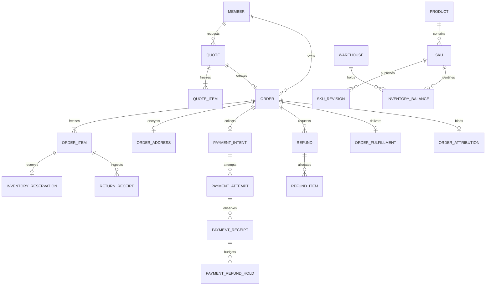

# 数据架构与核心约束

日期：2026-09-08。以仓库 Flyway V001–V032 和 Mapper 为依据，描述逻辑数据模型；不表示已连接当前运行库检查。返回 [文档导航](README.md)。

## 1. 数据组织

主数据和正式交易事实持久化到 MySQL。大多数业务表携带 tenant_id，跨对象引用使用租户复合键限定范围；渠道商户/交易号等外部路由键在必要处全局唯一，不能机械地把所有唯一键都改成仅租户内唯一。

生产访问走本域 Mapper XML；跨域资金、库存和会员事实经 Port 组合。缓存不是资金事实来源，MyBatis 缓存不能替代锁定读。模式演进由 [Flyway 迁移](../transaction-server/src/main/resources/db/migration/) 管理，已执行的历史迁移不重写。

## 2. 核心关系图

下图是主要业务关系，省略部分复合租户键、流水和回执；线条表达业务关联，不承诺全部为物理外键。

## 3. 表目录与归属

以下为迁移中的全部业务建表，按职责分组；`flyway_schema_history` 由 Flyway 自身管理，不纳入业务表。各字段的最终定义应顺序应用后续 ALTER，不能只读首次 CREATE。

| 数据域 | 表 | 主要用途 |
| --- | --- | --- |
| 通用事务 | tc_command、tc_operation_audit | 命令去重/结果、操作审计 |
| 事件 | tc_outbox、tc_outbox_replay_receipt、tc_outbox_maintenance | 原始事件、发布 ACK、重放回执、维护游标 |
| 准入/任务 | tc_admission_policy、tc_job_lease | 租户新增受理策略、持久任务/租约 |
| 会员 | tc_member、tc_consent_document、tc_member_consent | 会员与同意文档/事实 |
| 消费事实 | tc_member_trade_fact、tc_member_paid_order | everPaid、首单与每单消费证据版本 |
| 商品 | tc_product、tc_sku、tc_sku_revision | 商品主数据、SKU 与冻结发布版本 |
| 报价 | tc_quote、tc_quote_item | 服务端价格、数量与规格快照 |
| 库存 | tc_warehouse、tc_inventory_balance、tc_inventory_reservation、tc_inventory_ledger、tc_inventory_return_operation | 仓库、守恒余额、预占、流水、永久回库操作 |
| 订单 | tc_merchant、tc_order、tc_order_item、tc_order_address、tc_order_attribution | 商户配置、订单冻结数据、地址密文、归因快照 |
| 支付 | tc_merchant_channel、tc_payment_intent、tc_payment_attempt、tc_payment_receipt、tc_payment_risk、tc_payment_callback | 渠道路由、意图/尝试、真实资金、风控和耐久证据 |
| 资金账本 | tc_money_ledger、tc_payment_refund_hold | 运营资金流水、实收上的退款预占/成功 |
| 退款 | tc_refund_policy、tc_refund、tc_refund_item、tc_refund_component_budget、tc_refund_callback、tc_refund_approval_receipt | 政策、申请/组件、预算、渠道证据、审批回执 |
| 履约/退货 | tc_order_fulfillment、tc_return_receipt、tc_fulfillment_ingress、tc_return_request | 整单交付/完成、实际验收、永久入口回执、RMA |
| 对账 | tc_reconciliation_case、tc_reconciliation_report_receipt、tc_reconciliation_operation | 差异案例、来源报告、只查单执行记录 |

资金账本是交易运营事实流水，不等于具备总账科目、试算平衡和完整清结算功能的财务总账。

## 4. 关键唯一约束

| 约束/唯一键 | 业务不变量 | 主要迁移 |
| --- | --- | --- |
| uk_command：租户+主体+操作+请求键 | 相同命令摘要唯一，结果原子提交 | V001 |
| uk_order_quote：租户+quote_id | 一个报价一单 | V005 |
| 库存余额/预占/操作引用唯一键 | 同仓 SKU 一份余额，同预占/操作不重复变化 | V001、V021 |
| uk_member_first_slot | 每会员只占一个首单槽位 | V006 |
| uk_payment_order | 每订单一个支付意图 | V007 |
| uk_attempt_no | 渠道请求号不可复用 | V007 |
| uk_provider_transaction | 渠道+渠道商户+真实交易号唯一 | V007 |
| uk_normal_receipt | 同订单只有一个正常收款槽位，异常资金另存 | V007 |
| uk_money_business | 同业务资金流水只记一次 | V007 |
| uk_job_business | 同租户/类型/业务引用一个任务 | V008 |
| uk_refund_source、uk_refund_compensation | 永久来源申请去重；同异常实收唯一补偿 | V014、V018 |
| uk_provider_refund | 渠道真实退款号永久去重 | V013 |
| uk_return_source、uk_fulfillment_source | 验收/入口来源事件永久去重 | V021、V029 |
| uk_attribution_token、uk_attribution_command | 归因令牌单次消费及永久命令结果绑定 | V032 |

唯一键防重复，CHECK/条件更新限制数值，事务保证跨表共同成功；三者不能互相替代。状态决策使用当前读，不能根据 RR 旧快照判断是否已退款或已释放。

## 5. 金额和库存守恒

金额按最小货币单位的整数及 currency 保存，业务校验安全整数边界；禁止浮点小数静默截断为整数。订单冻结金额与 SKU 版本，退款按真实实收和原组件金额核对。

资金约束：`成功退款额 + 在途退款预占 <= 实收金额`；每组件同样受原冻结额度限制。UNKNOWN 保留预占，只有可信成功转已退，可靠失败/拒绝等合法分支才释放。正常退款财务状态与订单履约状态相互独立。

库存约束：`stock_total = available + reserved + sold`。退货时，累计实收不得超过原交付明细数量，累计可售回库不得超过原 CONFIRMED 预占数量。`sold` 表示尚未回到可售库存的净售出记账量，不能直接解释为客户当前持有数量。

| 回库场景，数量 r | 原仓 | 接收仓 |
| --- | --- | --- |
| 同仓 | available + r、sold - r；stock_total 不变 | 同一仓 |
| 跨仓 | sold - r、stock_total - r | available + r、stock_total + r |
| 全部不可售 | 只记录验收事实及实收预算 | 无可售库存增量 |

跨仓操作双仓 stock_total 总和不变，reserved 不变；两条派生流水与父操作、事实和预算同事务。不能用盘点 adjust 代替唯一退货回库。

## 6. 查询与索引设计

- 业务查询显式 tenant；列表采用 after/id 游标及有界 limit，普通订单列表不逐单读全部明细。
- job 的 runnable 生成列把 READY 与 RUNNING 可调度任务映射到同一槽位，`idx_job_due(tenant_id, job_type, runnable, next_run_at, id)` 支撑到期扫描与 SKIP LOCKED；租户发现有独立轮转索引。
- `JobLeaseMapper.nextTenant` 是内部跨租户发现例外，无 HTTP 任意扫描入口；不能据此放宽普通 Mapper 的租户条件。
- 对账事实按有界候选游标扫描后过滤，空页可能仍有后续；ID 上界不等于事务提交水位，不能仅用最大 ID 永久排除迟提交记录。
- 财务观测使用专项索引/有界查询，避免观测自身成为大表全扫负担。

以上是索引设计与代码路径，当前文档任务未运行 EXPLAIN 或大规模数据测试。上线前需验证实际选择索引、扫描行数、排序、锁等待与统计信息；只看存在索引不够。

## 7. 敏感数据、保留与迁移

地址密文保存密钥版本并绑定租户/订单/用途；回调保存密文及版本化保护信息。密钥由外部 Secret 注入，不进数据库、仓库或普通日志。历史密文仍依赖历史密钥可用，轮换不能直接销毁旧版本。

不可逆消费事实、真实资金、退款/履约/归因永久来源记录承担幂等和证据职责，不按普通缓存淘汰。当前 Outbox 维护负责补漏并保留 SENT 事实与 ACK，不执行 payload 删除；具体处理见 [维护操作](OUTBOX_MAINTENANCE_OPERATIONS.md)。法律/业务保留期限、备份周期和 KMS 轮换尚需部署治理确定，本页不虚构数值。

新增迁移必须有中文表注释与每字段注释，先隔离测试，再按授权升级目标库；运行账号与迁移账号分离。当前最高文件 V032，下个增量版本需在实施时重新检查是否仍可用。Mock/演示数据通过 dev-seed 正常业务服务入库，不硬编码在页面。

## 8. 数据验证入口

[MapperContractTest](../transaction-server/src/test/java/com/lrj/trade/server/MapperContractTest.java) 检查 Mapper/XML 合同；[QualityGateTest](../transaction-server/src/test/java/com/lrj/trade/server/QualityGateTest.java) 与 [FoundationTest](../transaction-server/src/test/java/com/lrj/trade/server/FoundationTest.java) 覆盖结构约束、注释和真实 MySQL 业务验证。数据量、生产备份恢复及在线 DDL 窗口不由这些功能测试替代。
