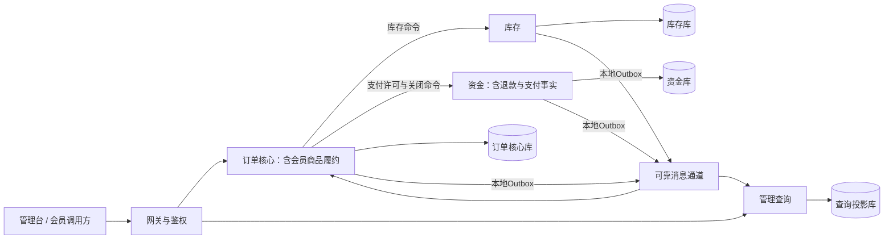

# 交易中心服务拆分设计 v1

日期：2026-09-09。状态：方案草案，供审查；不是已实施的架构或拆库授权。源码基线为已发布的3187c57；当前仍是同库模块化单体。本轮仅编写设计，不创建服务、迁移、Kafka主题或部署资源。上一轮文档状态同步改动保持原样。

入口：[当前交付状态](PROJECT_STATUS.md)；配套：[跨服务协议](DISTRIBUTED_PROTOCOLS.md)、[迁移与验收](plans/distributed-trade/MIGRATION_AND_ACCEPTANCE.md)。

## 1. 目标、约束与备选

目标是在保持交易不变量的前提下，允许部分业务独立部署和扩容。没有容量基线之前不承诺拆分提升吞吐；网络调用、中间状态和恢复机制会增加复杂度。当前Maven模块不是天然微服务边界。

| 方案 | 改动及扩展方式 | 一致性与工程代价 | 本次意见 |
| --- | --- | --- | --- |
| A：保持模块化单体，API/Worker多实例 | 保留同库事务，先验证租约、连接预算和热点 | 改动较小，运维成本较低；数据库与写热点仍共享 | 作为当前运行基线和第一阶段验证对象 |
| B：分阶段提取查询、库存，再分离资金 | 每阶段只切换一个明确的数据所有者，增加可靠协议 | 能针对负载扩容；必须改造事务、读合同和恢复 | 推荐的演进方向，每阶段独立验收 |
| C：所有Maven模块同时服务化、独立库 | 大范围同步替换Port、Mapper和部署 | 同时失去多处本地原子性；回退和故障定位困难 | 当前不采用，缺少支持该复杂度的容量和团队证据 |

推荐B以A为起点；不引入一个框架来假定外部支付、Kafka和数据库属于同一ACID事务。XA/TCC可以作为局部协议实现候选另行评估，不是此次默认基础；本方案的预占/确认/释放也不宣称已经实现某个TCC框架。

## 2. 当前代码中不能直接远程化的事务

| 当前事务 | 实际依据 | 拆分影响 |
| --- | --- | --- |
| 下单：会员/报价/商户校验、订单、逐SKU预占、归因与事件共同提交 | [OrderService.create](../transaction-order/src/main/java/com/lrj/trade/order/OrderService.java)、[QuoteService](../transaction-catalog/src/main/java/com/lrj/trade/catalog/QuoteService.java) | 简单HTTP查询不能替代锁定校验；库存失败后订单需有持久中间状态 |
| 支付许可与支付意图同事务；正常收款同时确认库存和订单 | [OrderService](../transaction-order/src/main/java/com/lrj/trade/order/OrderService.java)、[PaymentService](../transaction-payment/src/main/java/com/lrj/trade/payment/PaymentService.java) | 需要持久许可、关闭屏障和库存确认恢复，不能以超时取消 |
| 收款与会员首次确认事实原子更新 | [MemberTradeFactService](../transaction-member/src/main/java/com/lrj/trade/member/MemberTradeFactService.java) | 异步更新会员可能重复判首单；事实权威应跟随资金裁决迁移 |
| 退款申请、实收hold、商品项额度、审批、订单证据版本同事务 | [RefundService](../transaction-refund/src/main/java/com/lrj/trade/refund/RefundService.java)、[退款合同](REFUND_APPLICATION.md) | 两种退款预算保留同库；订单显示改为投影时必须更改读合同 |
| 退货验收与唯一回库、原预占预算共同裁决 | [退货合同](RETURN_RECEIPTS.md)、[数据约束](DATA_ARCHITECTURE.md) | 必须持久化验收及库存操作关联，禁止把退款数量当回库数量 |
| 订单、收款、首单证据在主库RR快照读取 | [OrderReferralEvidenceService](../transaction-server/src/main/java/com/lrj/trade/server/OrderReferralEvidenceService.java) | 拆库后不能用多个HTTP结果冒充同一快照；是资金拆分的前置门禁 |

## 3. 目标逻辑边界与首次物理边界

| 逻辑服务 | 所有权与最终裁决 | 第一版物理部署建议 |
| --- | --- | --- |
| 会员 | 资料、状态、同意；不拥有收款首单的最终裁决 | 暂留交易核心，直到冻结/准入协议评审完成 |
| 商品与报价 | 商品发布、价格和报价；订单持有不可变快照 | 暂留交易核心；可先提取只读展示，不能异步复制可售状态后直接裁决下单 |
| 订单 | 一报价一单、交易流程、商户准入、归因永久绑定、地址 | 交易核心及流程协调者 |
| 库存 | 仓库、余额、预占、确认/释放、退货回库 | 查询提取后优先独立，完整协议通过才切库 |
| 资金 | 支付、正常/异常实收、退款全流程及两层额度、资金账本、首次支付事实、对账 | 保持在一起；库存稳定后再与订单核心分离 |
| 履约与售后 | 交付、商业完成、RMA、验收来源 | 初期留在订单核心；退款裁决归资金，库存回库归库存 |
| 管理查询 | 各域只读投影及聚合展示 | 可以先独立；写操作路由权威服务，不能反向写业务表 |

图示为目标阶段，不是当前容器拓扑。HTTP或消息命令只是传输；对应服务仍须在本地事务中持久受理。

## 4. 现有48张表的目标所有权

每张表只有一个权威写入服务。表名暂沿用以便追溯，不代表现在执行DDL或完整照搬旧约束；跨服务外键需在迁移设计中改为本域唯一键、绑定事实与对账，禁止直接删外键就上线。

| 目标域 | 现有表 | 说明 |
| --- | --- | --- |
| 会员 | tc_member、tc_consent_document、tc_member_consent | 资料和合规事实，首次物理阶段仍属交易核心 |
| 商品与报价 | tc_product、tc_sku、tc_sku_revision、tc_quote、tc_quote_item | 原报价有效性与可售约束保留 |
| 订单 | tc_merchant、tc_order、tc_order_item、tc_order_address、tc_order_attribution | 不向资金/查询复制地址明文；归因令牌唯一消费不因失败补偿释放 |
| 履约与售后 | tc_order_fulfillment、tc_return_receipt、tc_fulfillment_ingress、tc_return_request | 先留订单核心；验收事实不可由库存处理结果倒造 |
| 库存 | tc_warehouse、tc_inventory_balance、tc_inventory_reservation、tc_inventory_ledger、tc_inventory_return_operation | 所有库存写入只由库存服务实施 |
| 资金：支付及风险 | tc_merchant_channel、tc_payment_intent、tc_payment_attempt、tc_payment_receipt、tc_payment_risk、tc_payment_callback | 商户渠道绑定必须来自已验证配置，不采信调用方传入任意渠道商户 |
| 资金：退款及账本 | tc_money_ledger、tc_payment_refund_hold、tc_refund_policy、tc_refund、tc_refund_item、tc_refund_component_budget、tc_refund_callback、tc_refund_approval_receipt | 实收预算、组件预算、免审批阈值和申请在同一事务；外部审批仍专用可信回执 |
| 资金：消费事实 | tc_member_trade_fact、tc_member_paid_order | 从现有member模块迁移所有权，不代表普通会员资料随迁；everPaid不可回退 |
| 资金：对账 | tc_reconciliation_case、tc_reconciliation_report_receipt、tc_reconciliation_operation | 保留差异与只查单语义，不因Saga异常自动结案 |
| 各服务私有机制 | tc_command、tc_operation_audit、tc_outbox、tc_outbox_replay_receipt、tc_outbox_maintenance、tc_job_lease | 按操作/业务归属迁移历史行，并在各库保有本地机制；不能建共享去重/事件库代替本地原子提交 |
| 准入策略 | tc_admission_policy | 当前策略权威先留订单核心；资金执行的独立硬门禁必须本地有效，拆分前定义版本及失效语义 |

查询投影、流程实例、跨服务Inbox、许可与终止记录需要后续增量模型；本稿不占用V034或假定下一迁移号。任何建表都要有表与全部字段中文注释。运行账号按服务隔离，禁止跨域直接读取业务表来维持旧事务假象。

初期可共用MySQL集群、独立逻辑库和账号；这不提供物理故障隔离。跨库事务即使技术上可执行也不作为服务协议。读副本和缓存只服务允许滞后的查询。

## 5. 不变量与裁决位置

| 不变量 | 权威位置 | 跨域约束 |
| --- | --- | --- |
| 一报价一单、同归因令牌唯一绑定 | 订单唯一约束及永久幂等记录 | 待库存失败也不能绕过旧请求重新消费同报价/令牌；重开须另立业务协议 |
| 同仓SKU余额不负、预占与回库不重复 | 库存本地事务 | 全订单多SKU一起预占；一期仍单仓，不引入跨仓预占Saga |
| 一订单一个支付意图、正常收款唯一，异常实收不丢 | 资金本地事务 | 所有尝试必须服从同一订单资金屏障 |
| 已退+在途≤实收；组件累计≤冻结可退上限 | 资金本地事务 | 冻结明细/金额先可信绑定；不得从查询投影读取上限 |
| 首次正常付费事实只确认一次 | 资金本地事务与会员事实行锁 | 本地确认顺序裁决，不按渠道时间或消息到达会员服务的顺序重排 |
| 零元不是首次付费；全退不抹除everPaid | 资金事实规则及订单零元流程 | 禁止用库存确认事件生成付费事实 |
| 已收款但库存未确认不能被标为已可履约 | 订单流程+资金事实+库存结果 | 保存真实收款，处于库存确认/异常处理中，不撤销财务事实 |
| 退货累计实收/回库受原购买与确认数量约束 | 履约验收预算+库存原确认预算 | 两边各自有唯一关联；跨域推进不能重复增加预算 |

## 6. 必须显式处理的语义变化

1. **建单中间状态**：现有下单成功包含全部库存预占。拆分后新增流程状态如WAIT_STOCK，不直接把它伪装成PENDING_PAYMENT；是否新增对外状态或提供独立operation资源须审查后版本化。这里的状态名仅草案，不是现有API枚举。
2. **收款与库存/订单脱钩**：资金可已确认但订单尚未推进。需要明确PAID的财务语义和可履约条件；首付确认时点将落在资金事务，可能早于库存确认，与当前同事务语义不同，必须在P2库存提取前审查，不能推迟到P3资金提取。P2资金仍在核心时也无法再把远程库存确认加入同一事务。
3. **商品/会员即时禁用**：当前有锁定校验。普通RPC“先查再下单”存在竞态；第一版不物理拆这些写域，但P2引入WAIT_STOCK仍改变原子完成时序：推荐在其本地提交时认定建单已获准，后续冻结/下架不回溯撤销该流程；新支付许可仍重检。该规则须在P2签收，不能声称保留同库便保留全部旧时序。若以后拆，必须选择持久许可加撤销屏障，并明确冻结成功是否等待在途许可排空；不能默认为异步最终一致。
4. **消费事实初始化**：资金拆分后通过可信会员注册事实幂等初始化，保留原registeredAt和不可变会员绑定；首次收款不能因初始化消息延迟而丢证据。回调先耐久保存，事实未就绪时待补齐，不返回虚构新客。
5. **证据快照**：现有管理证据/资格与订单退款证据版本依赖同库RR。禁止将多个服务响应拼成旧合同的同一快照。资金拆分前要单独设计版本化证据合同：财务证据由资金权威返回，履约引用带独立版本；消费者未签收前保留原部署边界。普通管理视图可标示分域observedAt与延迟，但不能据此发奖或支付。P2仍须复核每个证据接口实际依赖：若需要原子包含库存确认、履约或回库事实，其门禁也提前到P2，不能以金额表未拆库为由放行。
6. **全局首单范围**：资金服务必须在同一权威分区内串行裁决同tenant/member的正常收款；后续按商户拆资金库可能破坏此条件，须单独评估，不能直接横向拆分首单事实。

## 7. 责任、交互和运维

跨服务不得传播本地@Transactional语义或长时间持有数据库锁等待网络。所有外部网络在本地计划提交后执行；补偿也是新业务命令，不删除原账本、审批或验收事实。

订单协调建单/支付关闭流程，资金协调渠道支付/退款恢复，履约协调验收回库。每条流程只有一个明确协调者和版本；不是全局万能Saga服务。API和Worker属于同一业务服务，可共享其私有数据库；Worker实例用租约与token保护本地写入，但本地fencing不能撤销已发出的外部请求。

管理查询先从事件建立投影。现有7类V1事件不保证覆盖商品、报价、任务租约等所有管理页字段，P1须逐字段核对事实来源；缺少事件时补充经审查的新事件/CDC投影合同，或暂保留权威接口查询，不声称全部页面已有可重建投影。源端提交后投影才更新，写后读需要返回权威资源版本供前端补查；不能用跨库视图充当强一致交易查询。全量初始化需要可恢复快照与提交日志水位，不能用最大自增ID代表提交水位。

内部调用同时验证服务身份和租户/资源授权；透传traceId不传任意主体作为权限依据。证据与审批仍保持独立scope，消息生产权限、主题ACL与消费者职责需逐项配置。PII、JWT、归因原令牌和回调原文不进入普通事件或日志。

## 8. 审查决策清单

| 编号 | 推荐 | 影响 |
| --- | --- | --- |
| D1 | 分阶段拆分，先保持订单/会员/商品/履约同一核心 | 保留当前冻结与报价校验仍在本地，P2中间状态的时序变化单独签收 |
| D2 | 资金包含支付、退款两层预算、对账及首付事实 | 服务较大，但资金不变量保持本地事务 |
| D3 | 允许持久建单、关单、库存确认等中间状态 | P2之前需要新的API/前端状态及首单确认合同，不能静默改变旧状态 |
| D4 | P2先审查支付/首单证据含义；P3旧证据RR合同未替代前，不切分订单与资金数据库 | 保护营销/诊断证据口径；阶段进度受消费者签收制约 |
| D5 | 无支付许可才可本地发起库存释放；有许可必须等资金关闭屏障 | 故障时保留库存可能较久，优先资金正确性 |
| D6 | 外部审批与真实渠道仍独立验收 | 不把此设计视为开关启用或生产发布授权 |

这些是待审查设计选择，不要求用户现在提供技术参数才能完成本稿。后续实现须先明确D3/D4的兼容方案、容量目标及每阶段验收环境。
