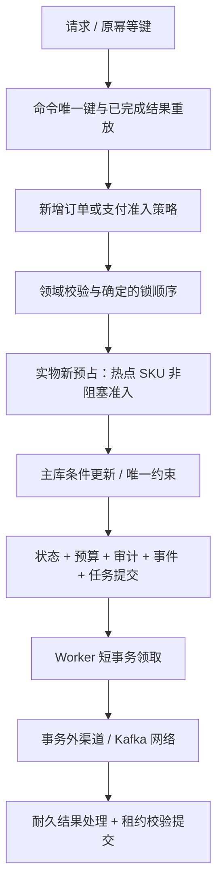

# 高并发与一致性设计

日期：2026-09-08。区分代码已实现的机制与尚待容量验收的结论。返回 [文档导航](README.md)。

## 1. 设计目标与证据边界

优先保证不重复创建业务、不超卖、不超额退款、不丢失真实资金，再通过有界并发和恢复机制控制负载。当前实现的正确性基础是 MySQL 本地事务、唯一键、条件更新和锁；Redis 仅加速商品展示。

已有专题提到商品查询 10,000 RPS、P99 ≤ 200ms、订单 500 RPS，以及千并发业务验证。这些是历史设计/验收目标，**本次未压测，也没有据此确认当前版本达标**。需要按 [容量验证方案](OPERATIONS_AND_CAPACITY.md) 在指定环境中测量。

## 2. 写入链路与保护层

图是主要写流程，不表示所有业务都经过全部保护。热点准入只限制新增预占；退款、可靠释放、确认和回调不能因为停止新增交易而停摆。

## 3. 命令幂等与永久业务去重

[Commands.java](../transaction-core/src/main/java/com/lrj/trade/core/Commands.java) 使用 `(tenant_id, actor_key, operation, request_key)` 唯一命令键：先 INSERT-if-absent，再锁定读；摘要不一致拒绝，已有结果则重放，只有新命令执行实际业务。结果与业务同事务提交，失败时不会保留半个成功结果。

命令不是所有业务的永久凭证。命令记录保留窗口之外还需领域唯一约束：一个报价一单、真实渠道交易号唯一、退款来源请求唯一、履约来源事件唯一、归因 jti 单次消费。不要清理永久事实后仍宣称不会重复收款或回库。

死锁/瞬时数据访问异常由 HTTP 错误层提示保留原键重试；调用方应有退避、抖动和总次数/总时间预算。错误码 `retryable` 与 HTTP 状态共同决定建议，不能为所有 500 自动换键重试。客户端 SDK 只给建议，不自动发送网络。

## 4. 防超卖与热点 SKU

[InventoryMapper.xml](../transaction-inventory/src/main/resources/mapper/inventory/InventoryMapper.xml) 在更新余额时带 `available >= 请求量` 条件，并核对影响行数；预占记录及流水使用唯一约束。不是先读一个库存数字再无条件写回。

主要守恒关系为 `stock_total = available + reserved + sold`，各数量非负。预占使 available 转入 reserved，确认使 reserved 转入 sold，释放使 reserved 回到 available。确认和释放锁同一预占，只有正确状态才能推进，重复不能生成第二份数量变化。

[HotSkuAdmission.java](../transaction-inventory/src/main/java/com/lrj/trade/inventory/HotSkuAdmission.java) 在 `Commands` 新预占业务中按 `(tenant, warehouse, sku)` 控制非阻塞许可，默认每键 32、跟踪键最多 4096。许可保持到外层事务完成，同事务同键复用；REQUIRES_NEW 挂起/恢复资源分开管理。没有许可时立即拒绝，避免继续进入库存锁竞争。

**作用范围是每个 JVM 实例**，不是分布式全局限流。热点检查发生在命令事务内，之前可能已经获取数据库连接和命令/领域锁，不能将它宣传为“连接池之前的零成本入口限流”。数据库正确性仍由条件更新和约束承担。

多 SKU 按稳定顺序处理，跨仓退货按仓库/SKU 顺序初始化并锁余额，降低互相等待。即便如此，唯一索引及外键也可能引入锁；仍需死锁重试与压测观察。

## 5. 锁与事务的使用边界

| 场景 | 主要顺序或规则 | 目的 |
| --- | --- | --- |
| 新订单/新支付 | 命令 → 准入共享锁 → 领域锁；库存按明细顺序 | 配置暂停与新增受理建立一致边界 |
| 正常退款 | 订单 → 支付意图/实收 → 已有 hold → 退款聚合/组件 → 末尾任务 fencing（若由任务执行） | 同一收款累计额度串行裁决 |
| 交付/完成 | 命令/永久来源回执 → 订单 → 履约事实 | 先确认归属及状态，再写不可逆事实 |
| 退货入口 | 命令/来源回执 → RMA → 订单域与原预占 → 有序仓库余额 | 幂等验收与唯一回库 |
| Outbox 发布提交 | Outbox → job | 事件结果与任务有效租约一起裁决 |
| job 领取/续租 | 单独 READ_COMMITTED 短事务，提交后网络 | 不把领取锁带到外部系统 |

这张表只列主要业务锁，不是包含每个 FK 隐式锁的全局证明；新增代码必须核对实际 Mapper。`Commands` 默认事务超时 10 秒；业务准入要求 REPEATABLE_READ，而 job 抢占显式使用 READ_COMMITTED。不能为了队列性能将整个应用统一改为 RC，否则缺省准入策略行的并发屏障会失效。

锁定读前禁用 MyBatis 缓存；租约续期/完成先等行锁，再用新 SQL 的数据库时间校验，防止锁等待跨过过期点却继续使用语句开始前的时间判断。

## 6. 商品缓存、单飞与故障降级

[CatalogQueryService.java](../transaction-catalog/src/main/java/com/lrj/trade/catalog/CatalogQueryService.java) 与 [RedisCatalogCache.java](../transaction-server/src/main/java/com/lrj/trade/server/RedisCatalogCache.java) 的职责：

| 机制 | 已实现行为 | 防护对象 |
| --- | --- | --- |
| 租户与代次键 | 环境/租户/发布代次/查询身份隔离；代次为随机 UUID | 跨租户污染、发布前后旧值混用 |
| 正/负 TTL | 正值 30–35 秒，空结果 2–2.5 秒 | 集中过期、重复查不存在资源 |
| 单飞 | 同进程同查询同代次共享一次回源，等待有时限 | 同键击穿 |
| 有界跟踪 | 默认最多 1024 个不同在途查询键 | 随机键冲击导致无界内存 |
| 主库预算 | 每实例默认并发 2、令牌补充速率 64/秒 | Redis 故障引起主库雪崩 |
| Redis 预算 | 默认在途 32、命令超时 50ms；另有连接超时 | 缓存自身拖慢请求 |
| 提交后失效 | 提交后交给有界执行器轮换代次，失败靠 TTL 收敛 | 事务内等待网络、提交后伪失败 |

速率预算允许令牌桶初始/累积突发，不是任何滑动秒内绝不超过 64 次。单飞也不是跨实例的全局单飞；N 个实例可能各回源一次。

缓存关闭、不可用或载荷校验失败仍走同一个主库预算，满额返回忙；不会无限制回源。等待单飞或 Redis 时不允许加入业务事务。旧回源写旧代次，不写入刚发布的新代次。展示允许短暂陈旧，实际可售、报价和资金判断仍由主库裁决。

## 7. 人工与自动准入

[AdmissionService.java](../transaction-core/src/main/java/com/lrj/trade/core/AdmissionService.java) 的租户策略分别控制新增订单和新增支付。写配置有版本与审计；新增命令在领域锁之前取得策略共享锁。已经完成的幂等结果和已有支付尝试优先返回，回调/退款/查单/恢复继续处理。

自动保护由 [AutomaticAdmissionGate.java](../transaction-core/src/main/java/com/lrj/trade/core/AutomaticAdmissionGate.java) 和后台采样配合，将人工允许与自动安全状态取逻辑 AND，不覆盖管理员配置。默认关闭；显式启用后，首次样本前、样本过期、采样失败或存储映射不可信时停止新增受理。

默认积压高/低阈值 10000/5000，磁盘暂停/恢复余量 5/10 GiB，采样间隔 15 秒、样本寿命 45 秒。高低阈值构成滞回，避免反复开关。积压统计有截断下界，不能当成任意规模的精确总量。磁盘必须指向数据库实际存储卷，不能取 API 容器根目录冒充。

这些是代码初值，不是已验收生产阈值。自动保护只控制新受理，不能撤销此前已接受的资金计划。

## 8. 可恢复任务与隔离

[JobLeaseService.java](../transaction-jobs/src/main/java/com/lrj/trade/jobs/JobLeaseService.java) 与 [JobLeaseMapper.xml](../transaction-jobs/src/main/resources/mapper/jobs/JobLeaseMapper.xml)：

1. 业务事务按 `(tenant, job_type, business_key)` 唯一入队，重复不重启 DONE/REVIEW。
2. `FOR UPDATE SKIP LOCKED` 按到期索引有界领取，避免不同 Worker 等同一行；每次接管递增 fencing_token，租约时间取数据库 UTC。
3. 领取事务提交后，形成业务计划并在末尾校验租约，再事务外访问渠道。
4. 结果提交、重试或转 REVIEW 必须参加业务事务并校验 owner/token/未过期。旧 Worker 提交失败使本地副作用一并回滚。
5. ORDER_RESOLVE 的 wake_generation 防运行期间新唤醒被旧退避覆盖；不靠重新启动已终态的旧支付恢复任务。

常驻运行按租户游标轮转，八类通道为 PAYMENT_CALLBACK、PAYMENT_RECOVER、ORDER_RESOLVE、REFUND_CALLBACK、REFUND_RECOVER、REFUND_COMPENSATE、OUTBOX_PUBLISH、RECON_QUERY。通道独立线程池、队列有界，线程总数上限 16；发布/查单关闭时对应通道为零，不领取。

租约只防陈旧进程提交本地数据库，不能阻止已经发出的远程请求。因此渠道同号幂等、关闭证据和耐久 Inbox 仍必需；“拿到锁”不等于跨系统恰好执行一次。

## 9. Inbox/Outbox 可靠性

支付/退款 Inbox 保存经可信适配器验证后的密文证据和引用，业务消费由任务恢复；重复来源事件去重。真实资金先被保留，业务冲突转核对，不能因为订单终态或 Worker 失租而丢弃事实。

Outbox 与业务同事务写七类 V1 载荷和发布任务；关闭发送仍入队。发布前严格核验持久载荷与索引绑定，发送原 JSON。Kafka 使用 acks=all 和幂等生产者，但 ACK 后本地提交失败仍会重发相同 eventId。消费者必须永久去重并按聚合版本处理乱序，同一分区键不保证多个 Worker 的跨事务发布顺序。

| 故障点 | 持久状态 | 恢复原则 |
| --- | --- | --- |
| 本地业务提交前崩溃 | 整体回滚 | 同键重试 |
| 已建立渠道计划、网络结果未知 | 稳定请求号和任务仍在 | 查询原号，保留额度 |
| Broker 已 ACK、SENT 未提交 | 事件可能已投递 | 原 eventId 重发，消费者去重 |
| Worker 失租后完成 | fencing 拒绝本地提交 | 新 Worker 接管；真实证据仍需耐久接收 |
| 永久错误/超过自动恢复预算 | REVIEW 留存 | 受控核对，不伪造业务失败/成功 |

受控重放、永久回执和扫描操作见 [Outbox 操作](OUTBOX_OPERATIONS.md)、[维护](OUTBOX_MAINTENANCE_OPERATIONS.md)。SENT 只代表 Broker ACK，不代表外部业务签收。

## 10. 扩容限制与验证要求

当前未实现数据库分片、库存分桶、读写分离路由或全局 Redis 库存。只有在容量结果指出瓶颈后才应评估这些演进，避免破坏同库事务边界。

API 扩容会同时放大 Hikari 连接数、热点许可和主库回源预算；单热点 SKU 最终仍竞争主库同一余额行。同会员、同商户、准入策略及数据库外键也可能成为热点，需要按真实负载观察等待分布。

现有测试入口包括 FoundationTest（真实 MySQL 竞争/回滚/租约/金额数量约束）、CatalogQueryTest、RedisCatalogCacheTest、AutomaticAdmissionTest、WorkerRuntimeTest、KafkaEventPublisherTest。默认 `mvn verify` 不等于运行 RedisCatalogCacheIT/KafkaPublisherIT，更不等于压力测试。本次只核对源码和文档，执行计划与容量结果须另行存证。
