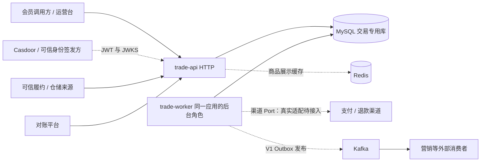
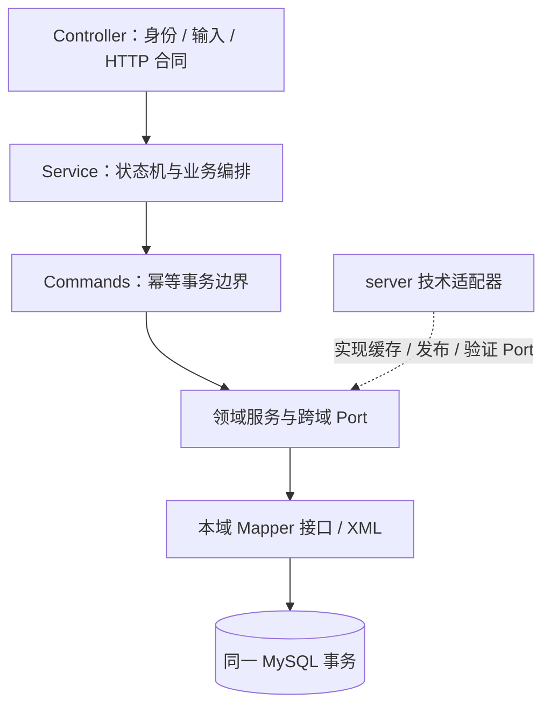

# 交易中心项目架构

日期：2026-09-08。范围：当前仓库源码与部署配置。返回 [文档导航](README.md)。

## 1. 系统定位

交易中心负责会员交易身份、商品与报价、库存、订单、支付收款、退款、履约退货和交易事实输出。采用 **Maven 多模块的模块化单体**：领域模块编译到同一个 Spring Boot 服务，跨领域资金与库存协作通过 Java Port 加同一 MySQL 数据源事务完成。模块数量不代表独立微服务数量。

技术基线来自 [根 POM](../pom.xml) 与 [服务 POM](../transaction-server/pom.xml)：Java 21、Spring Boot 4.0.2、Spring MVC/Security、MyBatis、Flyway、MySQL；Redis 用于可选展示缓存，Kafka 用于可选 V1 事件发布。运营台位于 [frontend/apps/console](../frontend/apps/console/README.md)，由 Cursor 负责前端开发。

## 2. 系统上下文与运行架构

图中虚线表示可选或依赖外部接入，不表示当前进程已启用。API 与 Worker 使用同一工程镜像和逻辑库，Compose 分为两个进程；Worker 没有宿主端口映射，但仍是同一 Spring 应用，不是另一个独立领域服务。API 固定禁用任务领取及 Outbox 发布，Worker 通过 profile 显式启动。

交易侧保存资金事实和异常，不负责生成外部渠道账单、营销奖励或物流事实。可信外部系统仍需按 scope、主体白名单、开关及来源合同接入，不能凭一个普通管理员令牌执行全部内部接口。

## 3. 模块职责与直接依赖

以下只列同仓库直接 Maven 依赖；具体定义以各模块 POM 为准。

| 模块 | 职责 | 直接依赖 |
| --- | --- | --- |
| transaction-core | Actor、校验、Commands、审计、Outbox、准入、跨域 Port、对账通用能力 | 无其他本仓库模块 |
| transaction-member | 会员、同意记录、不可逆消费事实 | core |
| transaction-catalog | 商品/SKU 发布版本、报价、展示缓存抽象与回源预算 | core、member |
| transaction-inventory | 仓库、余额、预占/确认/释放、退货回库、热点保护 | core、catalog |
| transaction-order | 商户、订单/快照/地址、支付屏障、履约退货、归因 | core、member、catalog、inventory |
| transaction-payment | 渠道配置、意图/尝试、收款、风控接口、退款资金 hold、支付恢复端口 | core、member、order |
| transaction-refund | 退款申请/组件预算、审批、渠道恢复、退款 Inbox、异常补偿 | core、order、payment |
| transaction-jobs | 持久任务、租约、八类 Worker、公平轮转 | core、payment、refund |
| transaction-server | HTTP、认证、外部适配、配置装配、Flyway、种子、集成测试 | core、member、catalog、inventory、order、payment、refund、jobs |
| transaction-client-sdk | 错误解码与保守重试建议 | 无其他本仓库模块 |

core 中的 Port 使业务能够请求同事务入队而不反向依赖 jobs；server 负责装配 Redis/Kafka/身份等技术实现。SDK 不负责自动网络重试。

## 4. 分层与调用方向

这是职责图，不表示每次读取都经过 Commands。写命令通常由 Commands 开启或加入本地事务；需要与调用方整体提交的领域方法使用 `MANDATORY`。跨域通过 Port 组合，Mapper/XML 按领域归属管理；各域禁止绕过拥有方直接修改其他领域的数据。

MyBatis 禁用二级缓存并设置一级缓存为 `STATEMENT`，锁定读必须到达数据库；显式 resultMap 保持 ID、版本与时间映射。生产 SQL 放在 Mapper XML，DDL 放在 Flyway 增量迁移中。详见 [持久化分层](PERSISTENCE_DESIGN.md)。

## 5. 两类一致性边界

**本地强一致边界**：业务状态、库存/资金预算、命令结果、审计、领域事件及需要的任务共同提交。创建多 SKU 订单任一预占失败，整单回滚；正常收款确认组合订单、库存、会员消费事实和资金流水。

**外部恢复边界**：先短事务形成稳定渠道计划并提交，再事务外调用网络，结果走耐久证据/Inbox 和短事务处理。Kafka ACK 与 MySQL 不属于一个原子提交，Outbox 必须允许重投；外部渠道超时属于未知结果，不能释放库存或退款预占。

这套设计依赖当前同库事务。未来拆成独立微服务需要重新设计一致性、额度归属和恢复协议，不能仅将 Maven 模块分别启动。当前没有用 Redis 库存或跨服务分布式事务替代 MySQL 裁决。

## 6. 身份、敏感数据与系统边界

JWT 由 SecurityConfiguration 验证签名、issuer、audience、时间、非空 subject 和规范正整数字符串 tenant_id；管理员还需 `trade.admin`。租户来自认证结果，业务 SQL 显式传租户，资源查询再校验本人/本租户归属。

地址以 AES-GCM 密文保存；回调使用版本化密钥环保护，数据库保存密钥版本和密文而非密钥。默认地址查询不返回明文。回调内部 Port 并不等于已交付真实渠道验签 HTTP；必须由可信适配器验证外部原文。

归因签名验证、订单永久快照和权威主体映射是不同步骤。默认 `UnavailableSubjectMapping` 返回 Pending，不能把普通会员 ID 直接当作营销全局主体。真实渠道、KMS、WMS 和消费者接入状态见 [业务说明](BUSINESS_GUIDE.md)。

## 7. 部署与演进约束

[Compose](../deploy/compose.yaml) 复用 dev_infra 的 MySQL 8.4、Redis 7、Kafka 3.8 网络实例，不创建公共中间件。数据库运行账号和迁移账号分离；演示数据通过 dev-seed 写入专用库。

可分别增加 API 与 Worker 副本，但每实例连接池、缓存回源预算、热点准入和后台线程都要累加计算。主库写入能力与热点行锁不会随 API 副本线性增长。生产网关、多可用区数据库、备份恢复、Kafka 复制/ACL 和完整告警需要部署层证据。

## 8. 源码阅读入口

- [TradeController.java](../transaction-server/src/main/java/com/lrj/trade/server/TradeController.java)、[SecurityConfiguration.java](../transaction-server/src/main/java/com/lrj/trade/server/SecurityConfiguration.java)：HTTP 与身份。
- [Commands.java](../transaction-core/src/main/java/com/lrj/trade/core/Commands.java)、[Outbox.java](../transaction-core/src/main/java/com/lrj/trade/core/Outbox.java)：命令事务与事件。
- [OrderService.java](../transaction-order/src/main/java/com/lrj/trade/order/OrderService.java)、[PaymentService.java](../transaction-payment/src/main/java/com/lrj/trade/payment/PaymentService.java)、[RefundService.java](../transaction-refund/src/main/java/com/lrj/trade/refund/RefundService.java)：交易编排。
- [WorkerRuntimeConfiguration.java](../transaction-server/src/main/java/com/lrj/trade/server/WorkerRuntimeConfiguration.java)、[JobLeaseService.java](../transaction-jobs/src/main/java/com/lrj/trade/jobs/JobLeaseService.java)：后台装配与租约。
- [运行配置](../transaction-server/src/main/resources/application.yml)、[数据库迁移](../transaction-server/src/main/resources/db/migration/)。
